# Практична робота №3 — Узагальнення, декоратори та утиліти типів TypeScript

**Варіант 5 · Предметна область: система управління аптекою (медикаменти)**

## Опис проєкту

Навчальний проєкт демонструє розширені можливості TypeScript, необхідні для промислової розробки на NestJS: **generics**, **utility types** та **декоратори**. Предметна область — аптека: у пам'яті зберігаються медикаменти, а робота з ними організована через типізований Generic Repository.

**Мета роботи:**

- опанувати generics, utility types та метапрограмування на основі декораторів;
- спроєктувати типізовані патерни: Generic Repository та обгортку `ApiResponse<T>`;
- створити DTO за допомогою `Partial<T>`, `Pick<T, K>`, `Omit<T, K>`, `Record<K, V>`;
- написати власні декоратори класу й методу (через `PropertyDescriptor`) та організувати модулі через barrel files.

### Що реалізовано

| Рівень | Реалізація |
|--------|-----------|
| **1** | Ініціалізація проєкту; базові generic-типи (`BaseEntity`, `IRepository<T>`, `ApiResponse<TData>`); `InMemoryRepository<T>` |
| **2** | `EntityStatus` (enum) та `MedicineEntity`; DTO через utility types (`CreateDTO`, `UpdateDTO`, `EntitySummary`, `EntityAnalytics`); метод `update` у репозиторії |
| **3** | Декоратор методу `@LogExecutionTime`; декоратор класу `@FrozenEntity`; `MedicineRepository` з декораторами; barrel files (`index.ts`); виведення результату в консоль |

### Ключові типи

```ts
export interface BaseEntity { id: string; createdAt: Date; updatedAt: Date; }

export interface MedicineEntity extends BaseEntity {
    title: string;
    price: number;
    dosageMg: number;
    isPrescriptionRequired: boolean;
    expirationDate: Date;
    status: EntityStatus;          // Active | Archived | Draft
}

export type CreateDTO<T>  = Omit<T, 'id' | 'createdAt' | 'updatedAt'>;
export type UpdateDTO<T>  = Partial<CreateDTO<T>>;
export type EntitySummary<T> = Pick<MedicineEntity, 'id' | 'title' | 'price'>;
export type EntityAnalytics<T> = Record<EntityStatus, number>;

export interface ApiResponse<TData> {
    success: boolean; data: TData; timestamp: Date; meta?: Record<string, unknown>;
}
```

### Декоратори

- **`@LogExecutionTime`** — декоратор методу: обгортає оригінальний метод, замірює час через `performance.now()` і виводить `[BENCHMARK] Метод <name> виконано за N ms.`
- **`@FrozenEntity`** — декоратор класу: викликає `Object.freeze` для конструктора та його прототипу, забороняючи зміну класу в runtime.

## Структура проєкту

```
PR3_WebDev/
├── package.json
├── tsconfig.json
└── src/
    ├── index.ts                        # точка входу, демонстраційний сценарій
    ├── types/
    │   ├── base-entity.ts
    │   ├── medicine.entity.ts
    │   ├── repository.ts
    │   ├── dto.ts
    │   ├── api-response.ts
    │   └── index.ts                    # barrel file
    ├── repositories/
    │   ├── in-memory.repository.ts
    │   ├── medicine.repository.ts
    │   └── index.ts                    # barrel file
    └── decorators/
        ├── frozen-entity.decorator.ts
        ├── log-execution-time.decorator.ts
        └── index.ts                    # barrel file
```

## Інструкція запуску

### Вимоги

- Node.js 18+ (LTS) та npm
- Git (за потреби)

### Кроки

```bash
# 1. Перейти в папку проєкту
cd PR3_WebDev

# 2. Встановити залежності
npm install

# 3. Якщо створюєте проєкт з нуля (замість npm install)
npm init -y
npm install -D typescript tsx @types/node
npx tsc --init

# 4. Запустити проєкт
npx tsx src/index.ts
```

### Налаштування `tsconfig.json`

Для роботи декораторів у `tsconfig.json` має бути увімкнено:

```json
{
  "compilerOptions": {
    "experimentalDecorators": true,
    "allowImportingTsExtensions": true,
    "strict": true
  }
}
```

> Імпорти типів у проєкті використовують розширення `.ts` (`import type ... from './x.ts'`), а runtime-імпорти — `.js`, тому потрібна опція `allowImportingTsExtensions` (разом із `noEmit` або запуском через `tsx`).

### Очікуваний результат

Програма послідовно виконує чотири кроки: додавання медикаментів, оновлення через `UpdateDTO`, підрахунок аналітики за статусами та формування `ApiResponse`. Для методів `create`, `update`, `findAll` у консоль виводяться BENCHMARK-логи.

## Скріншоти виконання роботи

### Рівень 1

**Ініціалізація структури проєкту**

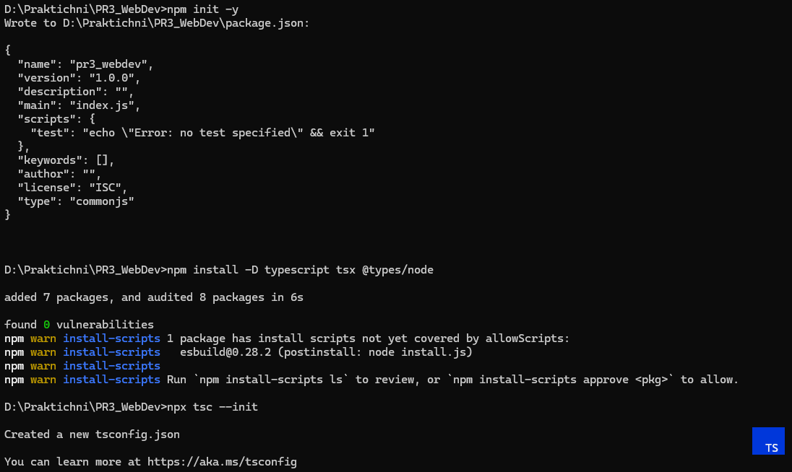

**Проєктування базових generic-типів**

`BaseEntity`:

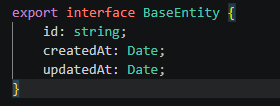

`ApiResponse<TData>`:

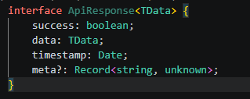

Інтерфейс `IRepository<T>`:

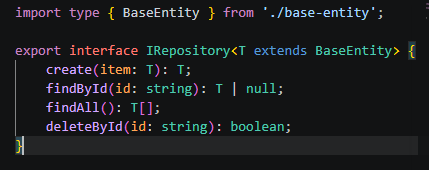

**Реалізація Generic In-Memory Repository**

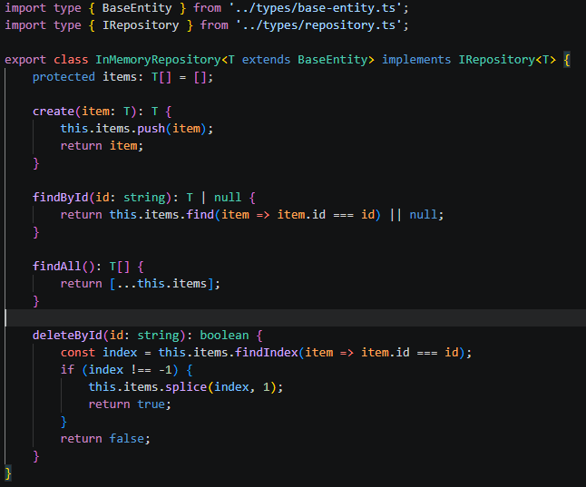

### Рівень 2

**Статус сутності та модель ліків**

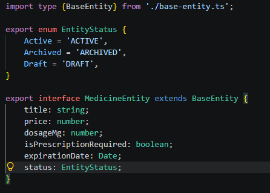

**Генерація типів DTO за допомогою Utility Types**

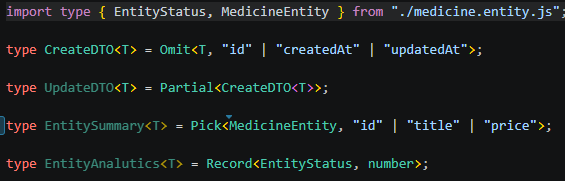

**Розширення репозиторію операцією оновлення**

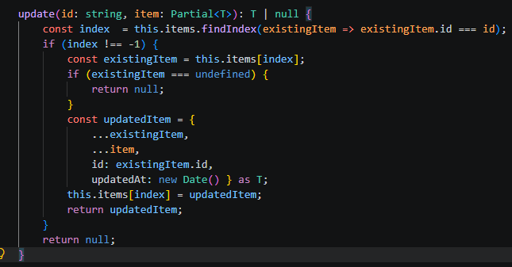

### Рівень 3

**Декоратор методу `@LogExecutionTime`**

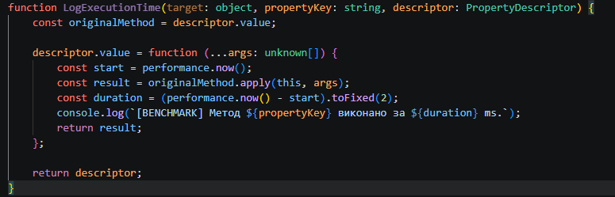

**Декоратор класу `@FrozenEntity`**

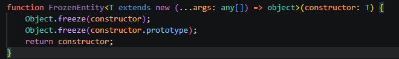

**Предметний сервіс з декораторами (`MedicineRepository`)**

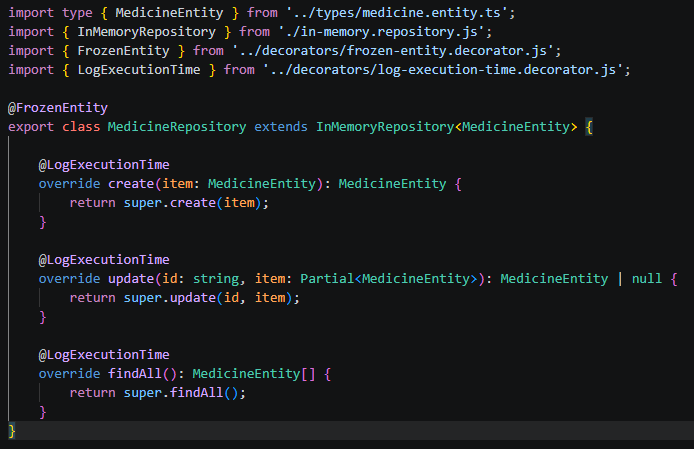

**Реекспорт усіх типів та інтерфейсів (Barrel Files)**

`types/index.ts`:

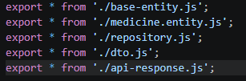

`repositories/index.ts`:

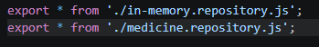

`decorators/index.ts`:

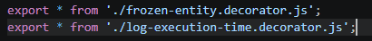

Загальний вигляд структури:

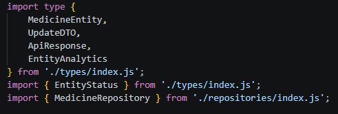

**Вивід у консолі**

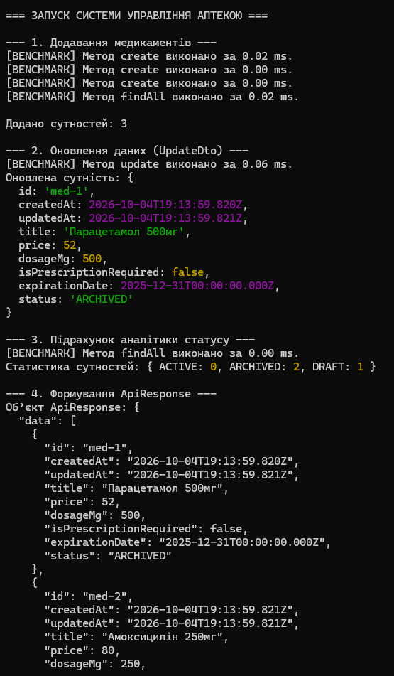

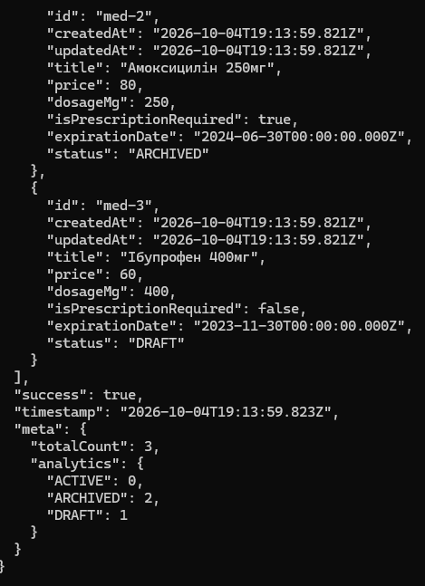

## Висновок

У ході практичної роботи я опанував розширені засоби TypeScript, що активно використовуються в NestJS. Було спроєктовано Generic Repository з обмеженням за базовою сутністю та універсальну обгортку API-відповіді, що дозволило повторно використовувати код для будь-яких сутностей.

За допомогою utility types (Omit, Partial, Pick, Record) створено DTO без дублювання коду, а власні декоратори методу й класу показали, як додавати наскрізну поведінку без втручання в бізнес-логіку. Barrel files зробили імпорти чистими, а структуру проєкту — зрозумілою.

Вивід у консолі підтвердив коректну роботу репозиторію, DTO, аналітики за статусами та декораторів. Здобуті навички стануть основою для побудови типобезпечних сервісів у NestJS.
